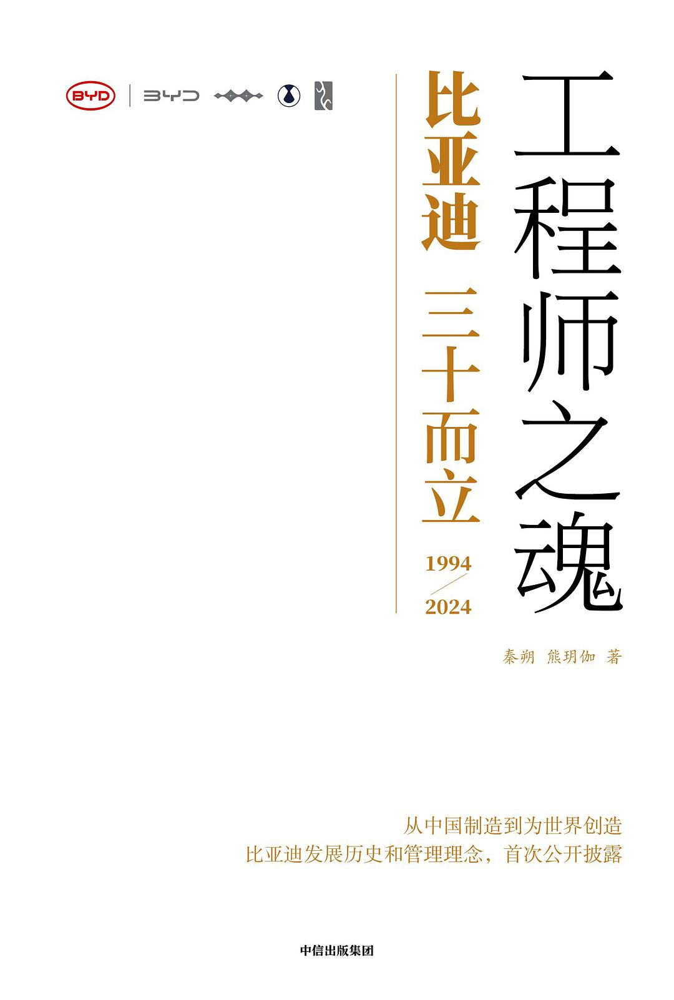

# ZIWEN.ICU

**[English](README.en.md)** · 简体中文

个人文章归档：网络长文的抓取、Markdown 转换、翻译与原创写作，配图全部本地化保存在 `images/`。

## 📚 文章索引

| # | 文章 | 篇幅 | 配图 | 更新 |
|---|---|---|---|---|
| 1 | [子文的由来：一部比亚迪内部漫画，和它的自嘲文化](<articles/子文的由来：一部比亚迪内部漫画，和它的自嘲文化.md>) | 1,375 字 | 0 | 2026-10-14 |
| 2 | [王传福：把工程师扛在肩上的人](<articles/王传福：把工程师扛在肩上的人.md>) | 1,740 字 | 1 | 2026-10-14 |
| 3 | [从《工程师之魂》洞悉比亚迪成功之道，8000字深度解读](<articles/从《工程师之魂》洞悉比亚迪成功之道，8000字深度解读.md>) | 7,669 字 | 12 | 2026-10-14 |

## ⭐ Star history

   

## 🔧 维护

目录约定：

- `articles/` — 文章（Markdown，中英独立成篇，文件名即标题）
- `images/` — 文章配图与生成的曲线图
