# 从《工程师之魂》洞悉比亚迪成功之道，8000字深度解读

> 作者：驾仕派 · 2025-02-28 · 来源：[爱卡汽车爱咖号](https://aikahao.xcar.com.cn/item/2357888.html)

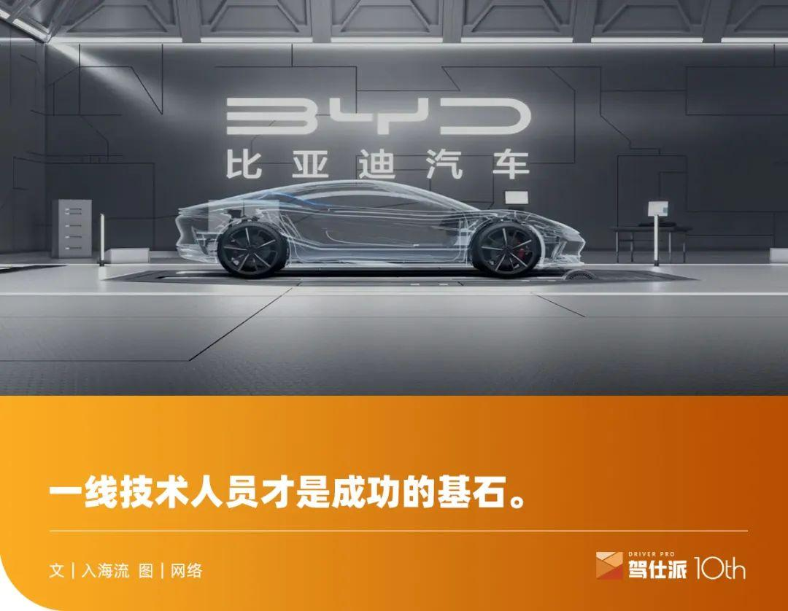

其实我是很喜欢读一些车企自己出的传纪或故事的书，比如最近几年连续读过广汽的《筑梦传奇》，吉利的《吉利收购宝腾路斯特始末》《吉利收购沃尔沃全记录》《新制造时代》，宝马的《体验宝马》，雷诺的《我的雷诺岁月》……

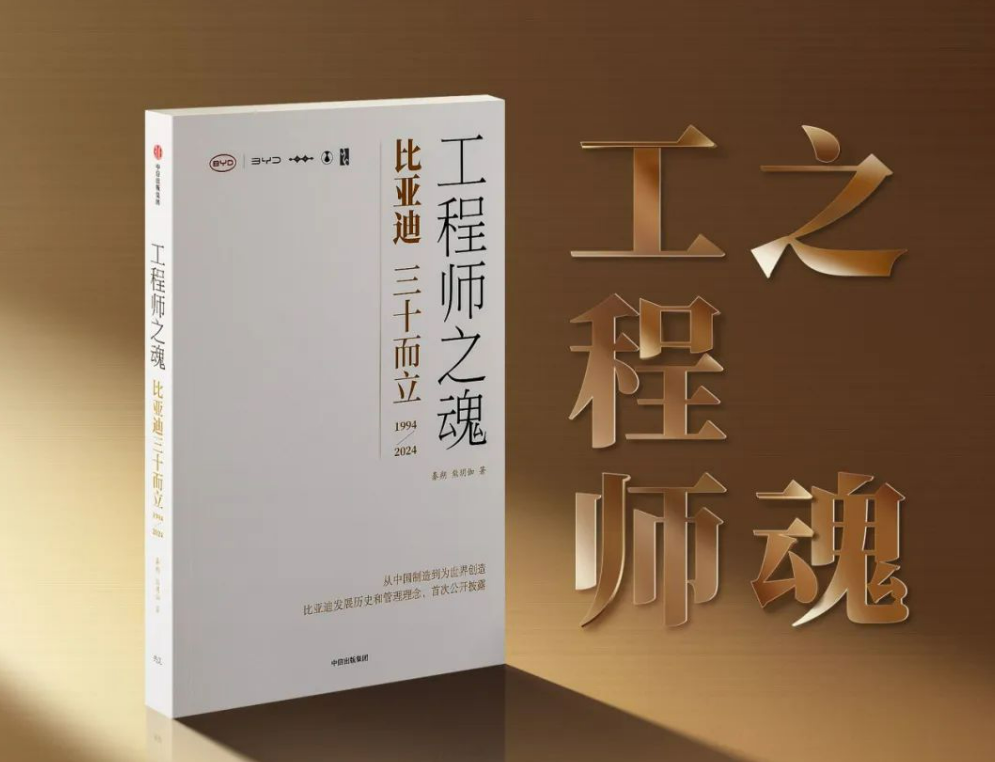

但当我看到比亚迪发行的这本《工程师之魂》时，还是大为震撼。虽然不可否认这是比亚迪借三十周年纪念进行的一次营销事件，但你会发现这是世界上第四家车企、国内第一家以“工程师”为主体命名的书籍，而相比《费迪兰德·保时捷：汽车工程师的传奇》《亨利·福特：工程师与企业家》《恩佐·法拉利：从工程师到传奇》——这些书更多是为品牌创始人歌功颂德外，比亚迪的《工程师之魂》则是实打实的以整个集团所有成员为主线条的一本纪实文学，并着重强调：

**一线技术人员才是三十年成功的基石。**

**【01】**

比亚迪对工程师的重视，早在王传福于2008年股东大会上的发言就初见端倪——

“公司最大的价值不在财务报表上，真正的资产是会计师和报表上看不到的，真正的资产是工程师团队所开发的技术和各种商业模式，这才是公司真正的价值。你们看到的是公司能赚多少钱，其实真正的推手是人，是技术，这才是公司成长真正的动力。”

这段话就跟前不久零跑在九周年之际拍了一张所有工程师的全家福、强调零跑九年来的成功跟工程师有很大关系有异曲同工之妙。

2024年，零跑刚好也迎来井喷式爆发，也许这便是成功者的背后都是英雄所见略同。

对比另外一位造车新势力创始人在公开场合大放厥词：“TMD一帮臭搞技术的，请问他们搞出了什么屁技术，毫无用户思维”的说法，就更让人佩服王传福的格局。

当然，王传福之所以这么在乎工程师团队，一个很重要的原因是：他自己就是研究生学历的工程师出身。

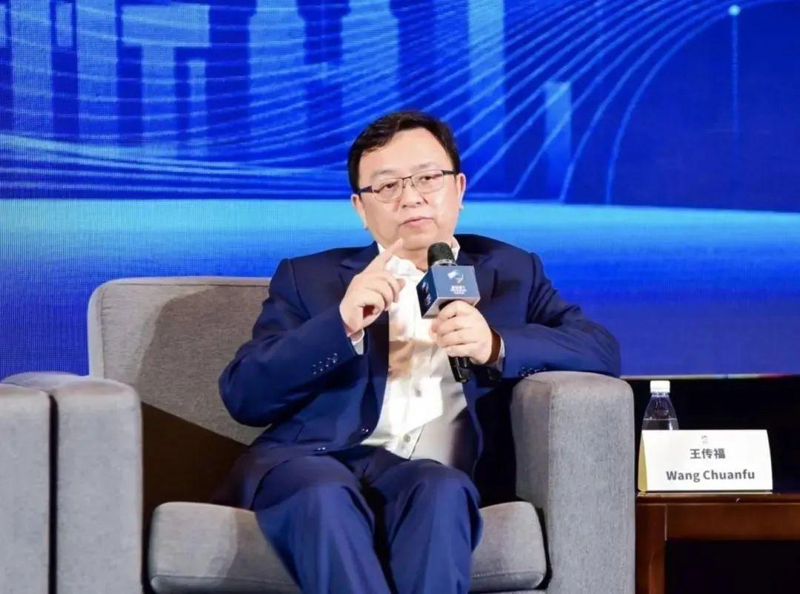

在90年代初，全国大多数人同龄人最多只能读到中专或高中时，他已经是研究生，足以说明他自己的实力。如果他不出来创业，本身就已是有色金属总院电池研究方向的专家，所以他能做到“看一眼其他公司的零件就知道怎么制造”。

在王传福早期的办公桌上，一直放着一把尖嘴钳，他本人就是拆解电池的高手，创始团队也几乎全是做技术出身。再对比一下最近何小鹏自曝被自己供应链团队所骗，花了九个月时间才把钢材采购的猫腻搞懂，你就会明白：

制造业技术出身和做互联网出身的人，在对经营制造型企业的理解上，差距还是可以清晰感知的。

尽管这本书一出来就有无数的梗在网上被嘲笑，而实话实说，这些年我也一直以批判的眼光来看比亚迪，很少提出表扬。

我当然知道很多人也会质疑书中的一些细节，其实艺术都是来源于生活高于生活，部分细节肯定略有加工——但假如你只是为了去挑刺，那花这么多的时间去阅读这么厚一本书就太不值当了。

本着把书读薄的原则，再结合我自己这些年的亲身经历，我们不妨也来看看比亚迪在目前成功的背后，究竟有哪些不为人知的奥秘和值得学习的地方。

**【02】**

虽然比亚迪现在最成功的产品是汽车，但全书400页正文用了五分之一的篇幅来回顾王传福制造手机电池的历史。而从这里面的很多故事，就能看出比亚迪今天造车的很多举措，其实都和那段历史是颇有渊源的。

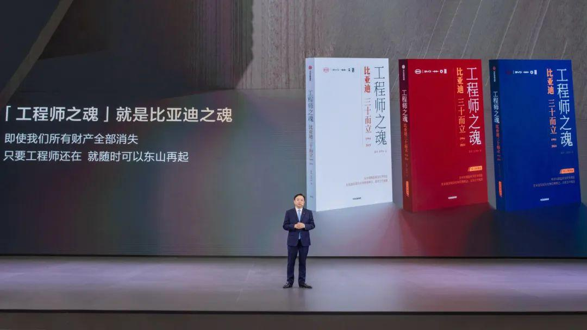

早在1997年，比亚迪就攻克了钢带拉浆技术，将手机电池负极材料由发泡镍改为镀镍的穿孔钢带，减少镍的使用，让一支电池降低成本近一元，比例达12%，镍材料的月消耗从五六百万降至数十万。

通过工程师的创新，只花了日本企业十分之一的成本就建成了镍电池的生产线，因此在给摩托罗拉报价时，才有勇气把日本企业报价6美元的电池报成2美元。

有了电池技术革新成功的案例，王传福通过不断走访和调研美国和日本的汽车厂，通过堆人和堆工程师的战术，才有了后来比亚迪的汽车模具成本仅为日本车企四分之一的优势，才能让比亚迪有资本在汽车行业重新洗牌、走向成功。

从这里也可以看出，比亚迪低成本的价格战并不是造车时才有，而是一直根深蒂固在王传福的骨子里——只有低价格才能在这个竞争残酷的世界里存活。而要想低价格，就只能通过工艺创新和设备改善降本，这些理念早在比亚迪造手机电池时代就已经初见端倪。

今天的比亚迪整车敢打价格战，很多人只看到了供应链降本。但事实却是大量的内部创新和改善起了更大的作用，否则，光靠供应链的涸泽而渔哪有那么大的资本，来源源不断的降低整车价格？

**【03】**

王传福从做手机电池开始，就一直强调工程师的两个特质：一是研究事物之间是如何联系的；二是努力找出事物联系背后的原理。

他要求电池研发人员做机理报告，一个一个问每一个问题的原理是什么，在遇到手机电池品质问题时，会要求做100个一模一样的不合格品来重现根本原因——其实这就是今天汽车行业普遍应用的8D解析方法。

如果没有王传福当年这种对工程师打破砂锅问到底的要求，也许比亚迪就不会率先研发出领先竞争对手的刀片电池，以及仰望U8原地转圈、下河浮水的功能。

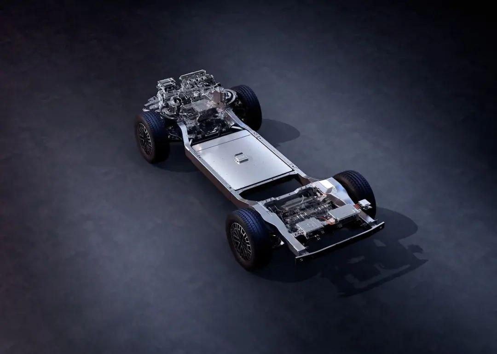

当然过于重视技术研发也有一些弊端。比如王传福在90年代就要求市场人员出差坐公交，如果打车那就要写半页纸的理由来合理解释才给批准，但是研发人员不管多少投入眨眼就签字。甚至直到今天，这一规定还在很多非研发的事业部流行，导致大量出差人员怨声载道，因为坐公共交通会浪费很多时间，甚至有些地方还没法通过公共交通到达。

如此快节奏的当下，时间就是金钱，在全中国车企员工出差都可以报销打车费的今天，比亚迪还在固执地坚持这一政策，实在费解，也能够看出技术出身的王传福的固执。

当然，从这里并不能推断出王传福就是一个“抠门”的人。在刚创业的九十年代，手机还是个稀罕物时，王传福就给科长、主任等管理人员配了手机，后来又鼓励经理级别买车，25万以内的车最高可以补贴60%，这让一批管理层员工在九十年代就开上了本田、别克等高级轿车，可见王传福从手机电池创业时起，就非常重视管理人员的福利。同时从这里也可以看出，他很早就在内部采取了补贴政策。

在对管理人员有福利政策刺激的同时，对普通工程师的福利待遇也不少。在2001年时，入职的大学生每个人都可以分一套40平方米的一室一厅单人宿舍，内部包含阳台、卫生间、厨房等，别说在寸土寸金的深圳很难做到，相信全国90%以上的企业都做不到这一点。

这一政策一直延续到现在都还存在，只不过现在因为招聘人数暴增，房间需求量增加，个别事业部的宿舍需求可能要排队等很久，但比亚迪也在想方设法通过寻租公寓满足员工的需求，如果员工是自己租房的，不同事业部还有不同期限的补贴。

除了提供宿舍，从2001年起，比亚迪开始自建商品房、并以至少低于市场50%的价格销售给内部员工，十年以后可以转手倒卖，这一政策也吸引了不少有志之士来坪山落户，比亚迪也正是因为这一有力政策激励了大量的老员工一直发光发热。

要知道其它企业很多普通职工在深圳工作一辈子都买不起房子，而王传福让很多普通人实现了这一愿望，所以他们一直对比亚迪心怀感激，在比亚迪努力工作，在比亚迪找同事结婚，买比亚迪车，住比亚迪房子，上比亚迪学校。很多人的命运就由此改变，不得不说，王传福没有亏待任何一个从创业初期跟过来的老员工。

当然在入职人数暴增的今天，商品房早就不能满足需求，现在都是通过工龄、工作绩效积累积分排队申请，但好在这一福利政策还在坚持。

比亚迪也正是因为有大量的宿舍、商品房、工厂、基地的基建需求，还专门成立了一个负责“盖房子”的事业部，从这里就可以看出比亚迪不光造汽车在自研，就连盖房子也有自研精神，把盖房子的成本都能比一般开发商降得低，这样才能以相比市场上更有竞争力的福利价格，把房子卖给自己的员工。

**【04】**

比亚迪在连续多个月以远超竞争对手的优势霸榜国内销量冠军时，也未放弃开拓海外的乘用车市场，虽然比亚迪的电动大巴早已在海外销售，但新能源的乘用车一直等到2022年元PLUS的上市、并推向海外市场，才算真正打响第一枪。

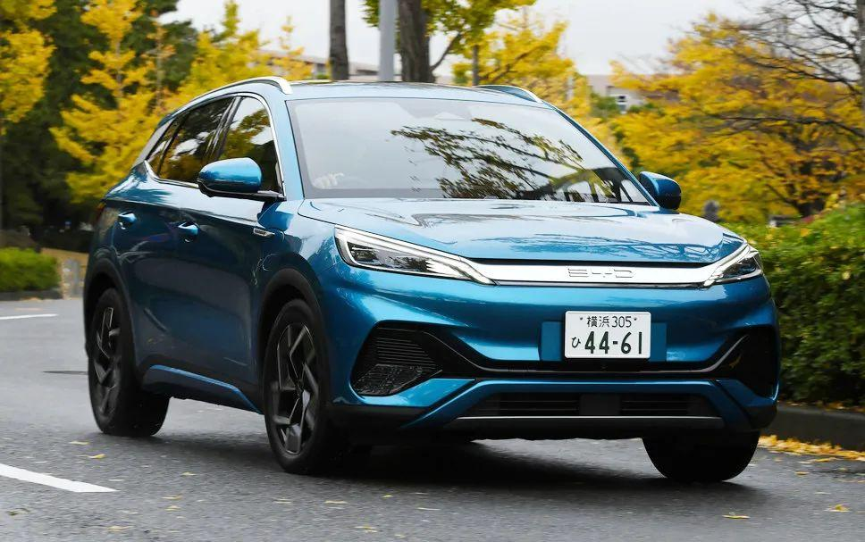

比亚迪乘用车市场的海外拓展离不开李柯的功劳，而李柯也正是90年代负责比亚迪电池出口的重臣。书中用了大量笔墨来讲述李柯在当年电池出海时的细节，也为后面负责比亚迪整车出海业务埋下伏笔。

毕竟凭借当年电池出海的海外关系网以及多年的海外业务经历，在比亚迪没有第二个人比李柯更适合来负责整车海外业务，所以当年的电池出海经历也为今天的整车出海积累了很多经验教训，这也是这本书为啥要花大量笔墨来写当年的手机电池创业历程。

说到李柯，就不得不单聊一些她的故事。

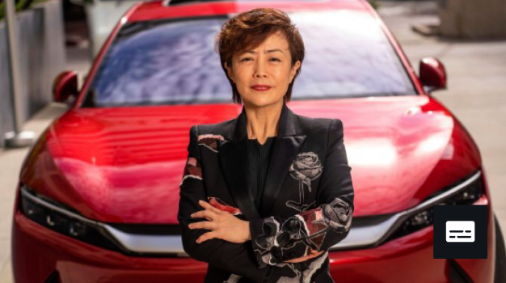

在入职比亚迪之前，李柯是《亚洲资源》的头牌广告销售顾问，而《亚洲资源》则是上世纪70年代开始在香港发行的专业贸易杂志。那会儿没有互联网，也没有什么B to B的说法，主要通过《亚洲资源》这类杂志将供应商信息提供给欧美买家，越来越多的欧美采购商也是把《亚洲资源》当成来亚洲采购的权威指南。

作为《亚洲资源》头牌广告销售的李柯固然深谙海外贸易之道，也掌握了很多客户资源，所以王传福在1996年拉李柯来加入比亚迪，在今天看来是非常重要的一个决策——当年比亚迪的手机电池市场主要在国外，如果电池贸易业务没有做起来，肯定就没有今天的比亚迪，更别说把比亚迪汽车做大。

而李柯今天又肩任了比亚迪整车出海的重任，相信她一定能像当年做海外电池业务一样成功的把比亚迪乘用车推向全球。

从这里也再次看出王传福对人才的重视，以及拥有别具一格识人眼光，不光重视技术人才，也重视销售人才，只有有了人才，才敢去谈创新，才敢去谈发展，才敢去谈做大做强。

**【05】**

李柯的加入，让比亚迪获得了与摩托罗拉、诺基亚等大客户合作的机会。而新的客户源的青睐不光是带来了订单，也给比亚迪提出了更高的品质要求，也为比亚迪造车奠定了品质体系基础。

摩托罗拉团队在比亚迪驻扎了半年，送给了比亚迪一本关于质量体系的书，王传福连夜要求员工翻译出来，里面的内容就是今天汽车行业常用的六西格玛质量管理体系。

在通过摩托罗拉的准入后，比亚迪先后导入了六西格玛、8D、4M1E、FMEA、SPC等质量管理工具，这些质量管理方法对于今天的汽车人来说都是非常熟悉的东西，而比亚迪却在电子时代的2000年就开始使用了。

在这里又要提到几个“连夜”故事——当摩托罗拉在审核时，白天提出的问题，第二天发现比亚迪连夜就把临时改进措施、改善的夹具都做好了；又比如首次给诺基亚开发的手机外壳测试开裂，如果隔天重测不行就要被取消合作，比亚迪连夜修改了模具，第二天顺利通过了测试。

再结合前面王传福要求连夜把书翻译出来，可见时间和响应决策的迅速性一直也是他所坚持的，对于比亚迪如此大的“大象”来说真的难能可贵，否则比亚迪今天不可能在新能源汽车领域领先一众对手这么大的身位。

所以从今天取得的成绩来看，比亚迪靠的绝不仅仅只是运气，这中间又是经历过多少个“连夜”，才能够达成今天的成就。同时你也可以明白比亚迪在新能源汽车开发项目上，为啥要大幅压缩周期和进度，也是受长期以来“连夜”思想的洗礼——不浪费一分一秒，早一天上市就早占领一份市场。

随着手机电池事业做大做强，各方面荣誉纷至沓来，王传福并没有被荣誉冲昏头脑，先后成立了LCD、光电子、柔性电路板、微电子、EMS、充电、ODM事业部，拓展了数码产品金属屏蔽罩、天线、镜头等新产品业务，开拓了苹果、戴尔、索尼、亚马逊、三星等客户。

但王传福并没有满足自己只是作为代工企业角色，对第六事业部提了三个要求：一是自己有研发，二是自己有设计，三是有自制能力。

所以我们在今天汽车事业群的弗迪科技身上也能看到这些思路，弗迪系虽然只是一个供应商，但绝不仅仅只做加工，实际上比亚迪的研发体系也不只有汽车工程院和规划院，弗迪系也支撑起了汽车悬架、车灯、电池、多媒体、空调、制动、安全系统、天窗、开闭件、域控、电子、线束、电机、发动机等多领域的研发，很多车型都是弗迪提供方案，汽车工程院和规划院进行整合。

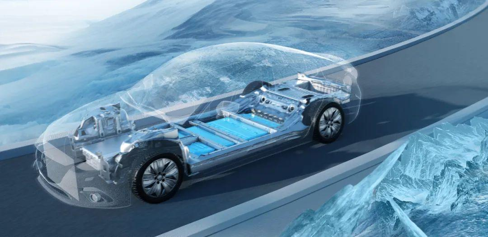

正因如此，弗迪不光给比亚迪提供零部件，还能在线束、空调、安全气囊等多个领域给中国其它自主品牌提供物美价廉的产品，这正是王传福在创业初期对电子事业部的自研的要求影响下来的。

比亚迪汽车在早些年一直是垂直整合的榜样，现在各个车企都在大肆宣扬的自研，其实不少就是来自于比亚迪的垂直整合概念。

**【06】**

虽然比亚迪汽车的成功是建立在最初收购秦川汽车的基础上，但光一个秦川汽车的壳，远远不可能让比亚迪后来走向辉煌。

王传福在收购秦川汽车的第四天，又与同济同捷签订战略合作，同样是也很重要的一步。看同济同捷的名字，顾名思义就是与同济大学校企联办的一家汽车工程设计公司。

同济大学汽车专业的实力可以跟清华和上海交大媲美，为中国汽车行业提供了大量的汽车设计类人才，很多早期并不怎么会造车的企业都会选择与同济同捷来进行工程方面的合作，如东风小康、海马、众泰、力帆等。

比亚迪为啥要选择与同济同捷合作，主要原因是当时的秦川汽车只是一个制造型的工厂，在研发上并没有源源不断的车型输出，唯一一款福莱尔还是借用奥拓的平台。

比亚迪汽车从零开始，只能凭借同济同捷在造型、车身、底盘、电气方面的优势，所以当时一口气与同济同捷规划了四款新车型，明确提出一年后、两年后分别要早出什么产品。足以证明那时的王传福就非常重视汽车规划的工作，从这里也可以看出后面为什么要把比亚迪规划院单独独立出来的原因。

汽车销售和开发做得好不好，关键要看规划序列成不成体系，否则这么多车型上马，就会乱成一锅粥。

收购秦川汽车后，王传福也深知西安地区技术基础和人才配套基础薄弱，于是首先把汽车研发中心建设到了上海，因为上海才是中国汽车人才的重镇（而不是深圳），只有在上海才能“抢到”更多更有实力的技术和管理人才，这其中最著名的案例，就是挖来了如今比亚迪汽车工程院的负责人廉玉波——他当年，就是同济同捷的创始人。

**【07】**

但是比亚迪跟同济同捷合作的首款车因为外形太丑并不成功，既浪费了钱也浪费了时间。王传福在市场碰了一鼻子灰后，担心资金链拖不起，果断停掉前面几个项目，决定另起炉灶，开发对标卡罗拉的比亚迪F3。

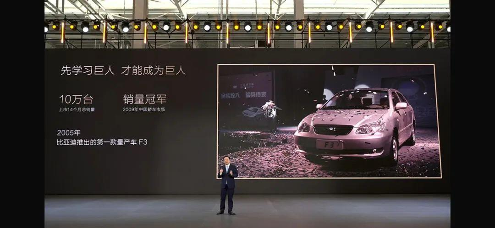

时间不等人，要求F3从立项到车型下线只能用12个月的时间。

从这里可以看出，比亚迪整车开发周期的大规模缩短，也并不是今天才有，而是从前几款车型就如此。也因此可以说缩短汽车开发周期，比亚迪才是真正的鼻祖——早在2005年就开始了，他们在这方面积累了大量的经验。

要知道那个时代的整车开发周期都是三年起步。王传福在坪山基地落成时，就要求每年按照三款新车投产的效率高速推进，再结合今天的多基地运营和新车上市数量，也差不多是这个节奏，说明比亚迪其实在2006年就已经高瞻远瞩的定下了未来的发展节奏。

为了快速推进项目，王传福当年亲自上马，要求研发分成白夜班两班倒，再结合之前造手机电池提到的无数个“连夜”，比亚迪汽车从一开始就一直强调快节奏，跟时间赛跑，才让自己这个并不占先发优势的“龟”，跑赢了绝大多数对手。

需要说明的是，尽管F3是依靠模仿丰田卡罗拉成功的，但王传福并不鼓励这种方式，“不能让别人觉得这个车像谁，哪怕再好看也不行”，所以后来的比亚迪坚持自主正向开发，请来了国际设计大师艾格。

后来现款唐和汉的成功不光是新能源动力总成技术的成功，也是比亚迪在售车型的颜值巅峰，代表了国内自主品牌造型设计的最高水准。

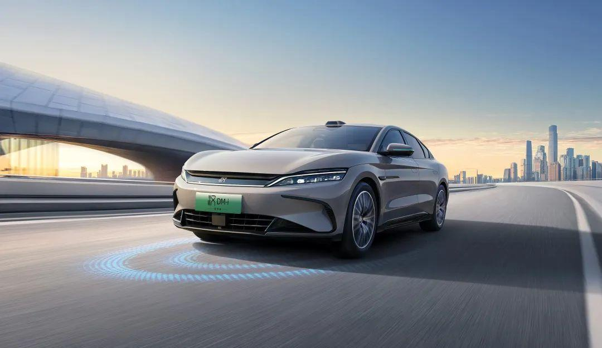

除此之外，王传福还支持项目组购买了几十辆顶级配置的各种品牌车，鼓励工程师们多开多用，增强体验感，让工程师明白高级车和普通车的区别在哪儿。

所以在比亚迪六角大楼底层的拆车小房间内，藏着大量的日系车，其中不乏一些挂港牌的右舵车。后来包括仰望U8的底盘也是参考了日产途乐的设计，研发仰望U9时，也是去搞了一辆港牌的兰博基尼来研究了很久。

尽管今天的比亚迪已经代表了国内自主品牌的一线水准，但站在师夷长技以制夷的观点上，这些对标车型也做出了卓越贡献。

**【08】**

比亚迪汽车在早期的开发时间缩短了，问题也就来了——供应链跟不上。因为别人都是三年开发周期，你一年就要开发出来，这让许多合资或欧美供应商不跟你玩，而愿意跟你玩的都是几家非主流供应商，而且还对销量没有信心，同时因为周期紧，任务重，比亚迪连零部件的技术需求都搞不明白，商务谈判很被动，也浪费了大量时间。

其实类似的困难，后面的很多新势力也都遇到，但新势力都是依靠烧钱来解决，提高供应商的开发费用，用高价购买供应商的技术或模具。但那时的王传福担心“烧钱模式”会很快把比亚迪造手机电池的利润烧完，并没有选择这样做，而是采用了自制零部件的策略——在这个背景下，才逼出了比亚迪自己制造零部件。

所以很多时候，人都是在绝境下才能逼出自己的极限，在舒适的环境中永远不会下狠心，这也是我始终认为：合理的“卷”价格会让整个产业链朝健康的方向发展——因为始终需要一个东西（一种压力）逼着产业朝前发展。

当然，自研也不是没有弊端。弗迪科技各个事业部为了让自己的零件在整车端被认可，八方出击，各个事业部的业务单元有重合，为了争抢同一个项目打得头破血流，这样就很难让自己快速进步，甚至有些还在开倒车。

所以后来王传福引入了竞争机制，放出一些零部件引入市场竞争，允许外部供应商与弗迪一起竞争，来倒逼弗迪提升自己的水平。

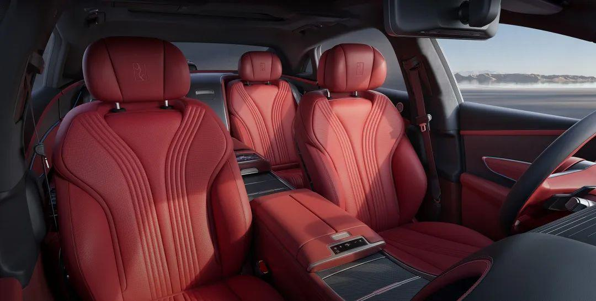

比如座椅就是一个很好的例子，最开始自己做，发现用的都是落后市场好几年的技术，还赚不了钱，品质也跟不上。于是在果断引入佛吉亚后，现在又重新把这一业务捡了起来，目前甚至仰望U7的这种高端座椅都可以自己做了。

**【09】**

汽车造出来了，那营销政策和宣传也要跟上。早在2004年，因为深圳禁摩，比亚迪的经销商通过用二手摩托置换汽车的方式来促销，一口气卖了180台福莱尔。

再看看今天的汽车置换政策，对于置换这个概念，比亚迪在2004年就开了先河。

当初F3新车上市时，因为营销能力不足，没法搞全国同步上市，只能先选竞争对手薄弱的地区试水，采取“农村包围城市”的战略，慢慢做大做强，其实这一理念也为今天的比亚迪的壮大打下了很好的群众基础。

先让最基础的底层市场知晓了比亚迪，恰好这一类群体又消费得起比亚迪主流车型的价位，在有了一定体量后再来围攻城市。到2024年，比亚迪在全国各个省份中也就只剩下两三个省份没有拿下区域市场的销冠，但这也只是个时间早晚的问题。

其实比亚迪的销售价格战，也不是今天才有。早在2010年，比亚迪的经销商就不光跟竞争对手打价格战，还要跟马路对面、几百米开外的另外一个比亚迪销售网的经销商打价格战，当时这也导致了很多经销商不满，部分经销商选择了退网。

其实这一幕今天还依然存在，如今很多比亚迪经销商都是把王朝网和海洋网的店面开得很近，有的甚至就是隔壁，比亚迪现在的很多新车都是一鸡多吃，同一个车既放到海洋网卖也放到王朝网卖，极个别的车还放到腾势在卖。这一策略无外乎想节约车型的开发成本，无死角的占领各级消费市场，但是也让经销商的竞争压力变得很大。对于这一做法，我个人持一些保留意见。

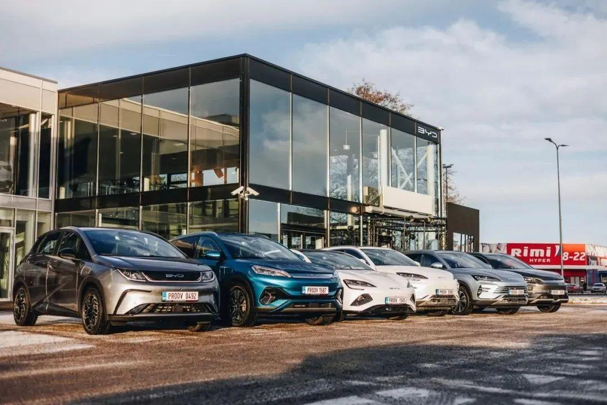

有了好的促销渠道和政策后，也需要好的营销公关策略跟上。比亚迪在这本书中首次公布了早在2010年的一些“退网”和“电池燃烧爆炸”等负面事件，王传福也首次意识到媒体关系的重要，意识到媒体如果对危机事件或者技术的不了解，会导致舆论的质疑声越来越大。

于是，李云飞（现任比亚迪品牌及公关处总经理）这个人物走上前台，让传播策略和沟通方式走向专业化，更努力的向公众普及新能源汽车的相关知识和技术。

所以你不得不佩服，“浮水”、“跳舞”、“圆规调头”、“连续的交付里程碑仪式”、“三十周年纪念”、“全民智驾时代开启”……这一系列营销事件的成功策划，也是比亚迪销量不断领先的因素之一。

在这本书中，首次公开提到了比亚迪在2013年就已经有了“迪粉”这个概念，尽管不少人一直认为“迪粉”是个贬义词。早在2013年，也是新媒体刚刚兴起的时候，可能绝大多数品牌还未完全意识到这一点。

当时的比亚迪虽然已经造车八年，但是品牌效应还未完全形成，当年的名气和销量还远不如长城和吉利。但在那个时候能从长计议，率先建立起有组织的迪粉群体“迪粉汇”，邀请迪粉参加技术解析会，分享迪粉的故事，提升大家的参与感和存在感，让迪粉队伍持续壮大。

伴随着销量的巨幅增加，迪粉为了维护品牌声誉度也做出了不可磨灭的贡献，迸发出了几何倍数的传播效应，所以早期迪粉组织的正规化，也算高瞻远瞩的一个举措。

**驾仕结语：**

通过简短的一篇读后感，我们不去分析比亚迪的技术，不去抨击比亚迪的负面，就事论事的通过它的一些花边新闻和一些创业过程的故事，可以管中窥豹：

比亚迪能走到今天，真的不是靠运气，更不是靠吹牛，而是踏踏实实地走过了很多的路，克服了很多的困难，才能有今天的成功。

当然，我们也希望品牌方也能听得进去一些负面的声音和一些好的建议，去不断完善自己，争取早日从一个伟大走向另一个伟大。

（END）

## 常见问题（FAQ）

**《工程师之魂》是一本什么书？**

比亚迪三十周年纪实文学，秦朔、熊玥伽著，中信出版集团 2024 年出版。全书约 400 页，以工程师群体为主线，首次公开比亚迪的发展历史与管理理念。

**书名「工程师之魂」出自哪里？**

出自王传福在发布现场的话：「工程师之魂就是比亚迪之魂——即使我们所有财产全部消失，只要工程师还在，就随时可以东山再起。」

**书里讲了哪些核心故事？**

手机电池时代的工艺创新（钢带拉浆让单支电池降本约 12%）、摩托罗拉与诺基亚带来的六西格玛与 8D 品质体系、收购秦川汽车后的整车之路（同济同捷合作、F3 十二个月下线）、垂直整合的弗迪系，以及李柯主导的出海与李云飞操盘的营销（含 2013 年「迪粉汇」的首次披露）。

**比亚迪为什么这么重视工程师？**

王传福 2008 年就在股东大会上说：「公司最大的价值不在财务报表上……真正的资产是工程师团队所开发的技术和各种商业模式。」他本人就是电池研究方向的工程师出身。

**这本书值得读吗？**

适合作为了解比亚迪创业史与管理方式的入门读物。本文作者的建议是：书中部分细节经过艺术加工，带着批判视角取其精华即可。

