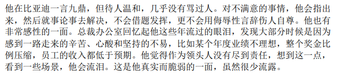

# 王传福：把工程师扛在肩上的人

> 由《工程师之魂》一段文字引出，结合公开报道整理
> 配图：`../images/cry.png`

## 一、一滴眼泪的重量

《工程师之魂》里有这么一段：他在比亚迪一言九鼎，但待人温和，几乎没有骂过人；对不满意的事情，他会指出，然后就事论事去解决，不会借题发挥，更不会用侮辱性辞藻伤人自尊。他也很感性——总裁办公室回忆起他这些年流过的眼泪，大部分时候是因为感到一路走来的辛苦、心酸和坚持的不易；若某个年度业绩不理想，整个奖金比例压缩，员工的收入都低于预期，他觉得作为领头人没有尽到责任，想到这一点，看到一些场景，他会流泪。

一位掌管近百万员工、年销四百多万辆汽车的企业家，最常被记起的不是他在发布会上的豪言，而是他为“员工收入低于预期”而自责落泪。

这滴眼泪，其实可以读成王传福的全部管理哲学：**他把公司看成一个技术共同体，而不是一台榨取利润的机器。** 领头人的责任，首先是让干活的人有体面的回报。

## 二、从“小米加步枪”到技术自信

1995年，他在北京有色金属研究总院做了多年电池研究的王传福辞职下海，从做房地产的表哥手里借来250万元，在深圳创办比亚迪。彼时充电电池市场95%以上握在日本企业手中，一条自动化产线的价格是天文数字。他的办法是最朴素的工程师思维：把产线拆开，能自己做的自己做，用“人工加夹具”替代昂贵的自动化。最终，比亚迪用相当于日企约四分之一的投入，造出了第一条镍电池生产线——“我们用小米加步枪打赢了飞机大炮”。

1997年亚洲金融风暴给了这套低成本、高弹性体系一个历史性的窗口，松下、索尼、诺基亚、摩托罗拉先后成为客户；到2008年，比亚迪成为全球最大的锂电池生产企业。

2003年他宣布造车时，舆论一片哗然，他的回应是一句典型的“王传福式”狂言：“一辆上百万元的车，在我看来也就是一堆钢铁。”这份狂气的背后不是鲁莽，而是他对“技术恐惧症”的长期不屑——“别人有，我敢做；别人没有，我敢想。遇到问题解决不了，不是因为你没有能力，而是你缺少勇气。”

## 三、工程师是资产，不是成本

2008年股东大会上，他说过一段今天读来仍振聋发聩的话：“公司最大的价值不在财务报表上，真正的资产是会计师和报表上看不到的，真正的资产是工程师团队所开发的技术和各种商业模式……你们看到的是公司能赚多少钱，其实真正的推手是人，是技术。”

这句话后来被反复验证：

- 2018年底，行业普遍转向三元锂电池，他在内部会议上坚持追问磷酸铁锂能否做到600公里续航，并提出把电芯“像刀片一样紧密排列”的构想——“刀片电池”由此诞生；
- 他至今给高管上“物理课、化学课”，从阳极氧化讲到原电池，只为了让技术被准确理解、被准确传播；
- 他要求应届生入职第一课由自己讲，内容浓缩为六个字：“谦虚、好学、吃苦”；
- 到2025年，比亚迪研发工程师达到12万人，直接向他汇报的总经理中，超过50%是自己培养的应届生；
- 他在内部册子《比亚迪基本纲要》里写明：决策者“只坐在办公室，是做不出好的决策的”，必须经常深入实验室、车间和门店。

“比亚迪是一个比较土的孩子，老老实实做事，勤勤恳恳念书。”2025年股东大会上，他再次用工程师式的自嘲定义自己的公司。不堆天才、不造神话，靠的是一整套选拔、培养、考核、激励的体系，把十几万人“像指挥一个人一样”协同起来。

## 四、温和，是一种稀缺的领导力

公开报道里的王传福，形象高度一致：不喜不嗔，言简意赅，偏爱专业问题；员工私下叫他“老王”；他一大早开车来公司，在大楼里工作一整天，食堂里等大家吃完了才去，一个人默默地吃。

《环球人物》的记者注意到，即使采访到深夜，陪同的高管打了哈欠，他的目光也从未游移。他对粉丝（“迪粉”）的珍视同样出人意料：“我们陷入困境时，他们给我们打气撑腰；网络上有不公正言论时，他们不遗余力地辩论；我们有了问题，他们也不是一味护短，经常批评和提醒。”

而《工程师之魂》补充了他性格里更柔软的部分：不骂人、不借题发挥、就事论事，却会因为员工收入低于预期而自责落泪。权力越大，越容易把人当成达成指标的工具；他偏偏把“人”放在了报表之前。这或许正是比亚迪能把一批批应届生熬成骨干、把师徒传帮带坚持二十多年的原因——**人们愿意跟着一个会为你流泪的领头人走很远。**

## 五、结语：工程师的魂，也是普通人的魂

从250万元借款、一条手工产线，到2025年460万辆的年销量与全球电动车销冠，比亚迪的故事常被概括为“技术为王、创新为本”。但技术不会自己长出来，它长在人身上。

王传福真正了不起的地方，或许不在于他说过多少惊人的狠话，而在于：他始终相信工程师团队是公司最值钱的资产，并且愿意为“没有让员工拿到预期的收入”而难受、而流泪。

一个企业的魂，最终是人的魂。把工程师当资产、把员工当伙伴、把自己当第一责任人——这就是王传福，一个会流泪的“技术狂人”。

## 常见问题（FAQ）

**王传福为什么被称为「会流泪的技术狂人」？**

《工程师之魂》记载：他在比亚迪一言九鼎却待人温和，几乎不骂人；若某年业绩不理想、奖金比例压缩使员工收入低于预期，他会觉得作为领头人没有尽到责任而自责落泪。

**比亚迪的第一条电池产线是怎么来的？**

1995 年王传福借来 250 万元在深圳创业，用「人工加夹具」替代昂贵自动化，以约为日本企业四分之一的投入造出第一条镍电池产线——「我们用小米加步枪打赢了飞机大炮」。

**「刀片电池」是怎么诞生的？**

2018 年底行业普遍转向三元锂电池时，他坚持追问磷酸铁锂能否做到 600 公里续航，并提出把电芯「像刀片一样紧密排列」的构想，刀片电池由此诞生。

**王传福如何定义工程师的价值？**

2008 年股东大会他说：「公司最大的价值不在财务报表上……真正的资产是工程师团队所开发的技术。」到 2025 年比亚迪研发工程师达 12 万人，直接向他汇报的总经理中超过 50% 是公司自己培养的应届生。

---

**资料来源**

- 《工程师之魂》相关书摘（配图片段）
- [揭秘比亚迪工程师方法论：12万“技术天团”是如何炼成的？｜21世纪经济报道](https://www.21jingji.com/article/20260123/herald/b323f4d737775c439473e9dfcd37f8df.html)
- [王传福：做电动车就是为了争口气｜《环球人物》/人民网](https://paper.people.com.cn/hqrw/html/2016-05/06/content_1725313.htm)
- [从《工程师之魂》洞悉比亚迪成功之道，8000字深度解读｜爱卡汽车爱咖号](https://aikahao.xcar.com.cn/item/2357888.html)
